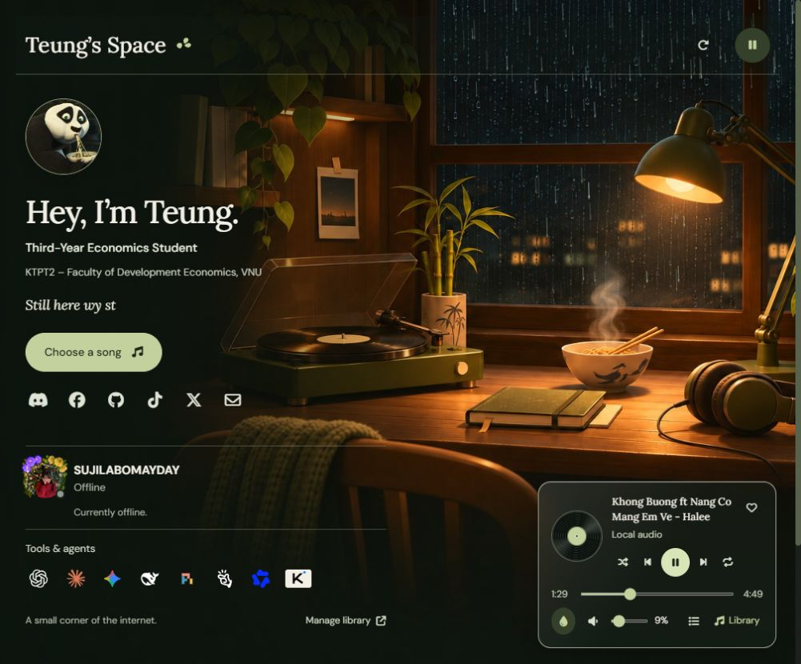
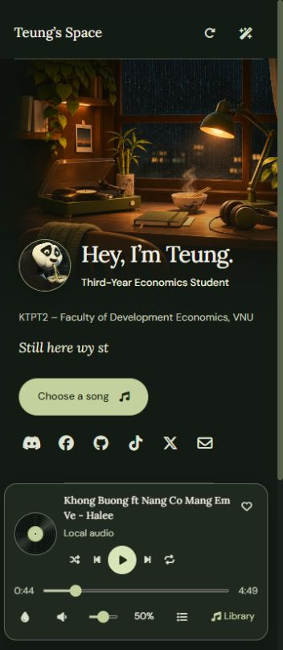

# Teung’s Space — After Hours

A little music, a little company.

[Visit the website](https://trungxsth.id.vn/) · [Library Manager](https://trungxsth.id.vn/admin.html) · [GitHub @trungst27](https://github.com/trungst27)

I’m **Teung**, a third-year Economics student at the Faculty of Development Economics, VNU. This is my personal corner of the internet: a place to introduce myself, share music and keep a little company. Over time, I’d like to grow it into a learning portfolio.



*An actual desktop preview of the v2 interface. The profile, Discord presence and player are live HTML; the room scene has a separate animation layer.*

<details>
<summary>View the mobile layout</summary>



</details>

## Contents

- [What’s here](#whats-here)
- [Listen and explore](#listen-and-explore)
- [Run locally](#run-locally)
- [Make changes](#make-changes)
- [Library Manager and Supabase](#library-manager-and-supabase)
- [Project structure](#project-structure)
- [Publishing and versions](#publishing-and-versions)
- [Next steps](#next-steps)
- [Credits and license](#credits-and-license)

## What’s here

### A personal room

- An After Hours scene with a rainy window, warm desk lamp, record player and noodle bowl.
- A Panda profile, supplied education details and social links.
- Live Discord identity, status and shared activity through Lanyard, with its own avatar and decoration.
- A curated row of eight AI tools and agents.
- Forest charcoal, warm ivory and muted olive, with Lora headings and DM Sans controls.

### A small music corner

The player sits at the bottom right, around a quarter of desktop width. It stays compact while the rest of Home remains open. **Library** reveals the collection above it; music does not require a separate tab.

- Local audio and official SoundCloud embeds share one playback controller.
- A vinyl record rotates during actual playback when motion is enabled.
- Play/pause, previous/next, seek, shuffle, repeat and volume controls.
- Search by song or artist, including Vietnamese text without accents.
- Mood filters, favorites and a play queue.
- Favorites, volume and the most recent selection are remembered in the browser.
- Only one music source plays at a time.

The bundled collection contains **two local MP3s and two SoundCloud links**. Mood tags are currently empty; the filters are ready for tracks to be tagged later.

### Motion and glass

- **Vinyl Portal:** a short record-opening entrance, with Replay, Skip and Escape controls.
- **Room ambience:** window rain, rising noodle vapour and a soft lamp glow, drawn on Canvas over the original scene.
- **Playback feedback:** the record and controls reflect the real player state; no simulated SoundCloud audio spectrum is used.
- **Motion control:** the header button enables or pauses animation and remembers the choice. Ambient loops pause in hidden tabs and when the scene leaves view.
- **Glass control:** the player’s droplet button toggles translucency. Its initial setting follows the system’s reduced-transparency preference; the browser remembers an explicit choice. An opaque fallback is available without backdrop-filter support.

## Listen and explore

1. Open [Teung’s Space](https://trungxsth.id.vn/) and select **Enter Teung’s Space**.
2. Music starts at **50% volume on the first visit**, then uses the saved volume.
3. Select **Choose a song** on Home or **Library** in the player to browse the collection.
4. Search, choose a track, save it with the heart or add it to the queue with **+**.
5. Use the queue button to view what plays next. Library and queue occupy the same area above the player, one at a time.

| Shortcut or control | Action |
| --- | --- |
| `Space` | Play/pause when focus is outside links, buttons and form fields |
| `Escape` | Skip an active intro, close the collection or close the queue |
| `Tab` | Move through links and controls with visible focus |
| Skip to player | Jump directly to the music controls |
| Replay intro | Replay the entrance and enable motion |

Older `#music` and `#library` links open the collection on the same Home page. Closing the collection or queue returns keyboard focus to its trigger.

SoundCloud playback depends on the track’s embed availability and browser playback rules. If a track cannot play, the interface offers retry controls and a link to the original SoundCloud page.

## Run locally

This is a **vanilla HTML/CSS/JavaScript** project. There is no package installation or build step.

From the folder containing `index.html`, start a static server with Python 3:

```sh
python -m http.server 8000 --bind 127.0.0.1
```

On Windows, `py -m http.server 8000 --bind 127.0.0.1` also works if the Python launcher is installed. Another static HTTP server can be used instead.

- [Home](http://127.0.0.1:8000/)
- [Library Manager](http://127.0.0.1:8000/admin.html)
- [Local preview without autoplay](http://127.0.0.1:8000/?preview=1#home)

Use HTTP rather than opening `index.html` directly: the collection is loaded with `fetch`. The preview flag only bypasses the entry screen on `localhost` or `127.0.0.1`; it does not bypass administrator authentication.

Google Fonts, Font Awesome, Lanyard and SoundCloud require an internet connection.

## Make changes

| Change | Where to look |
| --- | --- |
| Name, education, note and social links | `index.html` |
| Main Panda avatar | `#profile-picture` in `index.html` |
| Discord account | `data-discord-user-id` on `.discord-widget` in `index.html` |
| AI tools and logos | `.ai-tools` in `index.html`, `assets/logo/ai/` |
| Shared colors, type and Home scene | `styles.css` |
| Compact player and collection layout | `assets/css/home-player.css` |
| Bundled songs and mood tags | `assets/data/tracks.json` |
| Motion and glass preferences | `assets/js/script.js` |
| Portal entrance | `assets/js/vinyl-intro.js` |
| Rain, vapour and lamplight | `assets/js/room-ambience.js` |

### Add music before connecting Supabase

For a local track, place the audio file in `assets/music/` and add an entry to `assets/data/tracks.json`. Give it a unique ID, title, `source: "file"`, a relative `audio_url`, position and published state. Artist, cover and duration can be supplied when known.

For SoundCloud, use `source: "soundcloud"` and the full track or playlist URL in `soundcloud_url`. Playback uses the official widget; no SoundCloud API key or account connection is required. This does not synchronize an entire SoundCloud account.

Supported mood values are `chill`, `study` and `late-night`. Leave `moods` empty when a track has not been categorized. Keep existing IDs stable so browser favorites and selections remain associated with the right songs.

When the cloud library is configured, published database records become the primary source. The bundled JSON remains the fallback if cloud reads fail. The initial collection is also seeded by the Supabase schema; see the setup guide before switching sources.

### Discord presence

The configured account must be monitored by [Lanyard](https://github.com/Phineas/lanyard). Join the [official Lanyard server](https://discord.gg/lanyard) with that Discord account, then set its numeric User ID in `index.html`.

The client uses WebSocket updates with reconnection and REST polling as a fallback. **Unavailable** indicates a connection problem; **Offline** is a Discord presence state. The main Panda profile and Discord identity are intentionally separate.

## Library Manager and Supabase

**Current status: the frontend and bundled music work; Supabase is not connected.**

Library Manager can preview local files and SoundCloud links. Saving, uploading and publishing require a configured Supabase project and an authorized administrator. These cloud operations still need live verification after setup.

The implementation includes:

- Email/password sign-in through Supabase Auth.
- Administrator access through the `music_admins` table.
- Drafts, publication, editing, ordering and hiding tracks.
- Private audio storage with time-limited playback URLs.
- Public cover-image storage and database/storage access policies.
- Upload progress and preview before publication.

| Input | Implemented limit |
| --- | --- |
| Audio | MP3, WAV, OGG, M4A or FLAC; up to 50 MB; playback depends on the browser |
| Cover | JPG, PNG or WebP; up to 5 MB |
| SoundCloud | Full `https://soundcloud.com/` track or playlist URL |

### Connect the backend

1. Create a Supabase project.
2. Run [`supabase/schema.sql`](supabase/schema.sql) in its SQL Editor.
3. Create the administrator account and add its user ID to `music_admins`.
4. Add the public Project URL and publishable key to [`assets/js/config.js`](assets/js/config.js).
5. Sign in to Library Manager and verify uploads, drafts, publication and access policies.

Follow the full **[Supabase setup guide](docs/SUPABASE_SETUP.md)** for the exact steps. Only public browser configuration belongs in this repository; secret/service-role keys, passwords and personal access tokens do not.

Visitors can listen without an account. Favorites are browser-local and do not sync across devices. Uploads do not resume after interruption, and replacing a file does not automatically delete the old storage object.

## Project structure

```text
.
├── index.html                  # Home, profile, compact player and collection
├── styles.css                  # Shared appearance and room composition
├── admin.html                  # Library Manager
├── assets/
│   ├── css/                    # Home player and administrator styles
│   ├── data/tracks.json        # Bundled music collection
│   ├── js/                     # Playback, library, admin, presence and motion
│   ├── music/                  # Existing local audio files
│   ├── scenes/                 # After Hours imagery and provenance
│   ├── logo/ai/                # AI logos, source notes and licenses
│   ├── pfp/                    # Discord avatar and decoration fallback
│   └── back/                   # Original background video, retained
├── docs/
│   ├── SUPABASE_SETUP.md       # Backend configuration guide
│   └── images/                 # Actual desktop and mobile README previews
├── supabase/schema.sql        # Tables, policies, storage and ordering RPC
├── PRODUCT.md                 # Product scope and constraints
├── DESIGN.md                  # Visual system and layout reference
├── CNAME                      # Custom domain
└── LICENSE                    # MIT license and copyright notices
```

The runtime keeps responsibilities separate:

- `music.js`: one playback engine for local audio and SoundCloud.
- `library.js`: search, filters, favorites, queue and player interface.
- `library-data.js`: collection requests, local preferences and artwork fallbacks.
- `admin.js`: authentication, editor, previews and cloud operations.
- `lanyard.js` and `discord.js`: Discord presence and avatar decoration.
- `script.js`, `vinyl-intro.js` and `room-ambience.js`: entry, preferences and visual motion.
- `audio-visualizer.js`: a subtle main-avatar response to local audio.

Earlier typewriter, tilt and Neko scripts remain in the repository but are not loaded by the current interface. The original anime video is retained and stays paused on Home.

## Publishing and versions

The frontend is hosted on **GitHub Pages** at [trungxsth.id.vn](https://trungxsth.id.vn/).

| Item | Current value |
| --- | --- |
| Publishing source | `feature/after-hours-v2` |
| Publishing folder | `/` — repository root |
| Development branch | `feature/after-hours-v2` |
| Previous version | Preserved on `main` |
| Initial v2 preview tag | `v2.0.0-beta.1` |

Pushes to the publishing branch trigger GitHub Pages deployment. Local edits are not published until committed and pushed. Follow the deployment in [GitHub Actions](https://github.com/trungst27/trungst27.github.io/actions); the source branch is configured in [Settings → Pages](https://github.com/trungst27/trungst27.github.io/settings/pages).

The beta tag records the initial v2 snapshot. Later commits continue on the feature branch without moving that tag. A stable `v2.0.0` release can be created once the next release is ready.

For CSS or JavaScript updates, bump the corresponding query version in `index.html` so visitors receive the new asset. Keep `CNAME` aligned with the custom domain configured in Pages settings.

To republish the previous version, select `main` and `/` in Pages settings and allow deployment to finish. Changing the publishing source does not require rewriting either branch’s history.

## Next steps

- [x] After Hours Home and compact corner player.
- [x] Local audio, SoundCloud, search, favorites and queue.
- [x] Vinyl Portal and animated room material.
- [x] Live Discord presence and responsive layout.
- [x] Public v2 beta on the custom domain.
- [ ] Connect Supabase and verify the complete administrator flow.
- [ ] Curate covers, metadata and mood tags.
- [ ] Add learning projects and portfolio content.
- [ ] Prepare the stable v2 release.

## Credits and license

Personal direction and curation by **Teung**. Built with assistance from OpenAI’s ChatGPT and Codex.

- Fonts: Lora and DM Sans via Google Fonts.
- Interface icons: Font Awesome.
- AI logos: [asset sources and licensing notes](assets/logo/ai/README.md).
- Discord presence: [Lanyard](https://github.com/Phineas/lanyard).
- External music: SoundCloud’s official embedded player.
- Room imagery: generated for this project; [scene provenance](assets/scenes/README.md).
- README previews: actual browser captures of the After Hours interface, showing desktop and mobile layouts. Presence and playback values in the images are snapshots.

The code is distributed under the [MIT License](LICENSE), including the copyright notices recorded there. Third-party music, avatars, logos, fonts and artwork retain their respective ownership and license terms.
